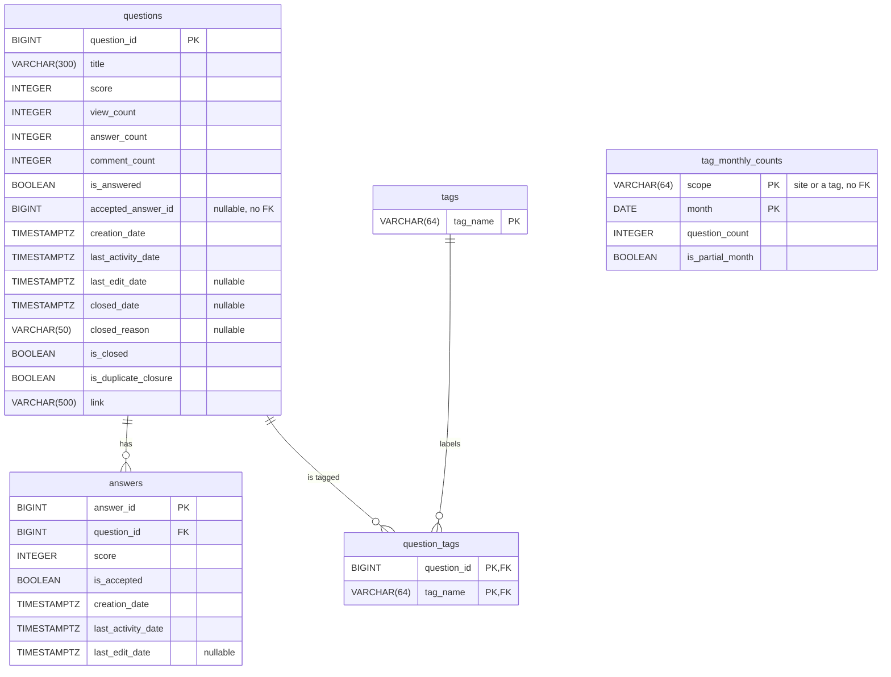

# DAEN 328 Term Project: Stack Overflow Activity Pipeline

A dockerized ETL pipeline that pulls Stack Overflow questions and answers from the
[Stack Exchange API v2.3](https://api.stackexchange.com/docs), cleans them with our own
transform functions, loads them into PostgreSQL, and shows them in a Streamlit dashboard.

No user or account data is collected (see [docs/extraction.md](docs/extraction.md#1-privacy-decision-our-phase-1-risk)).

## Dashboard questions

1. Which tags are growing or shrinking in question volume month over month?
2. How has overall site activity changed over time?
3. Which technologies (tags) tend to appear together?
4. Which tags receive the most attention (score, comments, views)?
5. How long does it take to get a first answer or an accepted answer, by tag?

## Repository layout

```
extract.py          API client: pulls questions, answers, monthly counts       (Carson)
transform.py        cleaning functions                                        (Jeremy)
load.py             schema + upserts + pipeline cursors in PostgreSQL         (David)
etl_common.py       shared run logic: lock, batches, summary
fill.py             job 1: pull data the database doesn't have yet
update.py           job 2: upsert questions that changed since the last run
status.py           read-only report: cursors, row counts, recent runs
streamlit_app.py    dashboard (not written yet)                               (everyone)
db.py               shared SQLAlchemy engine from .env
tests/, pytest.ini  pytest tests
docs/               docker guide, extraction and transform notes, API key tutorial
Dockerfile, docker-compose.yml                                                (Jonathan)
.env.sample         every environment variable, no secrets
```

## Run it

You only need Docker; there is nothing to install for Python. Pick a database in `.env`:

| Setup | Database | Use it for |
|---|---|---|
| **A. Neon** | our shared hosted PostgreSQL | the team: everyone builds the dashboard on the same data |
| **B. Local** | a PostgreSQL container on your machine | graders, trying it out, working offline |

1. Get your own free API key: [docs/stack-exchange-api-key-tutorial.md](docs/stack-exchange-api-key-tutorial.md).
2. `cp .env.sample .env`, then set `SE_API_KEY` (yours) and **one** of:
   - **A. Neon:** the team's Neon details (ask Carson), either as one `DATABASE_URL` line or as the separate
     `PGHOST`/`PGUSER`/`PGPASSWORD`/`PGDATABASE`/`PGSSLMODE`/`PGCHANNELBINDING` lines Neon's "Connect" dialog gives
     you. A pooled host (`-pooler`) is switched to the direct one automatically. Nothing else to start.
   - **B. Local:** leave `DATABASE_URL` blank, set `POSTGRES_USER` and `POSTGRES_PASSWORD` (any values), then start
     the database once: `docker compose --profile local up -d --wait db`.

   `.env` is git-ignored; never commit it.
3. Pull data (repeat until it says there is nothing left to fill):

   ```bash
   docker compose run --rm fill
   ```
4. Keep it current:

   ```bash
   docker compose run --rm update
   ```
5. See what is in the database and what the last runs did:

   ```bash
   docker compose run --rm status
   ```

Run the tests with `docker compose run --rm fill pytest`. **Full Docker guide** for both setups (all commands,
monitoring, troubleshooting): [docs/docker.md](docs/docker.md). A dashboard service gets added to `docker-compose.yml` later.

Every run prints a timestamped line per batch while it works and records itself in the `etl_runs` table
(when, requests used, why it stopped, any error), which `status` displays.

### The two containers

| | `fill` | `update` |
|---|---|---|
| Job | Only requests data we don't have yet | Finds questions that changed and upserts them |
| Pulls | Missing monthly counts; questions + answers created before the backfill cursor, newest first, down to `SE_BACKFILL_FLOOR` | Questions with activity since the watermark (new ones, plus old ones with a new answer, edit, vote or close); the current month's counts |
| Cursor in `etl_state` | `<site>:backfill` = oldest `creation_date` loaded, only moves backward | `<site>:questions` = newest `last_activity_date` loaded, only moves forward |
| Ends when | the floor is reached, or the budget/quota is spent | it has caught up, or the budget/quota/`SE_MAX_PAGES` is spent |

The first `fill` records "now" as the starting point of both cursors: `fill` walks backward from it
and `update` walks forward from it, so together they cover everything with no gap.

### Team pull workflow (sharing the 10,000-call daily quota)

Every run spends at most `SE_MAX_REQUESTS` API calls (default 10,000, the daily limit for one key).
The cursors are stored in the database, so on the shared Neon database, when one person's budget runs out,
the next person's run continues from there:

1. Use **your own** `SE_API_KEY` and your own network (the quota is per key *and* IP, so teammates on
   the same campus Wi-Fi share one quota).
2. `docker compose run --rm fill`. It prints how many requests it used and where the cursors are.
3. The next person repeats step 2 the next day.

Only one run can write at a time. If someone else's run is in progress you get
`another run is in progress against this database`; wait and run again. Before moving
`SE_BACKFILL_FLOOR` earlier, check how much data our Neon plan can hold.

### Neon or local: what differs

`db.py` picks the database from `.env`, first match wins: `DATABASE_URL`, then Neon's `PGHOST` lines, then the
local `POSTGRES_*` values.

| | A. Neon | B. Local |
|---|---|---|
| `.env` | `DATABASE_URL`, or Neon's `PGHOST`/`PGUSER`/... lines | `POSTGRES_USER`, `POSTGRES_PASSWORD` (no `DATABASE_URL`/`PGHOST`) |
| Start the database | nothing (always on) | `docker compose --profile local up -d --wait db` |
| Data and cursors | shared by the whole team | on your machine only, starts empty |
| Wipe it | in the Neon console | `docker compose --profile local down -v` |

The pipeline creates its own tables in whichever database it points at, and each database keeps its own
cursors, so the first `fill` against a new database starts from scratch. Details and troubleshooting for both:
[docs/docker.md](docs/docker.md).

## Layer notes

- [Docker guide](docs/docker.md): running, monitoring and troubleshooting the containers
- [Extraction](docs/extraction.md): sources, privacy, incremental pulls
- [Transform](docs/transform.md): cleaning decisions and next steps

## Schema and ERD



| Table | One row per | Primary key | Foreign keys |
|---|---|---|---|
| `questions` | Stack Overflow question | `question_id` | none |
| `answers` | answer to a question | `answer_id` | `question_id` → `questions` |
| `tags` | distinct tag name | `tag_name` | none |
| `question_tags` | (question, tag) pair; resolves the many-to-many between questions and tags | `(question_id, tag_name)` | `question_id` → `questions`, `tag_name` → `tags` |
| `tag_monthly_counts` | month of question volume for the whole site or one tracked tag | `(scope, month)` | none (see below) |
| `etl_state` | pipeline cursor (`<site>:questions` and `<site>:backfill`); not part of the data model | `source` | none |
| `etl_runs` | one fill/update run (start, end, status, requests used, why it stopped); not part of the data model | `run_id` | none |

**Third normal form.** A question's tags are not stored as a list on the question row. They live in
`question_tags`, so each fact sits in one place: a question's attributes in `questions`, an answer's in
`answers`, and the question-to-tag relationship in `question_tags`. Every non-key column depends only on
its table's whole primary key.

### Key decisions

- **`tag_monthly_counts.scope` has no foreign key.** `scope` is either `'site'` (all of Stack Overflow) or
  a tracked tag such as `'python'`. `'site'` is not a tag, so a foreign key to `tags` would reject it.
  A tracked tag can also be missing from `tags` if no question we pulled carried it yet. Monthly counts
  come from a different API call than the questions, so the two tables are not tied together.
- **`questions.accepted_answer_id` has no foreign key.** We only pull answers for questions in our window,
  and an accepted answer can still be missing (for example when quota runs out mid-run). A foreign key
  would reject the question. It would also create a cycle (`questions` → `answers` → `questions`), so
  neither table could be loaded first. `NULL` means "no accepted answer yet". To get the accepted answer,
  use `LEFT JOIN answers ON answers.answer_id = questions.accepted_answer_id`.
- **`answers.question_id` is a real foreign key.** `extract.py` only asks for answers of questions in the
  same run, and `load.py` loads questions before answers in the same transaction, so the parent row always
  exists. An answer can also attach to a question loaded in an earlier run. If an answer ever arrives whose
  question is in neither place, load skips it and counts it in the run summary, so one bad row can't fail
  the whole run.

## Load layer

`load.py` takes the `TransformResult` from `transform.py` and writes it to PostgreSQL.
It connects through `db.py`, which reads `DATABASE_URL` (our Neon database) or the `POSTGRES_*` variables
from `.env`. No credentials are in code.

| Step | Decision | Why | How it is implemented |
|---|---|---|---|
| 1. Create the schema | Tables, keys and indexes are written by hand with SQLAlchemy Core `Table(...)` definitions. `pandas.to_sql()` is not used. | The assignment requires our own definitions, and `to_sql()` guesses types and creates no keys. Writing the tables in Python keeps one definition for both the DDL and the upserts. | `metadata.create_all(conn, checkfirst=True)` at the start of every run creates whatever is missing and leaves existing tables alone, so the pipeline creates its own tables and no table is made by hand. |
| 2. Convert pandas values | Turn every cell into a plain Python value before inserting. | psycopg2 can't send pandas `NA`/`NaT` or numpy integers. Without this, missing values fail or arrive as the wrong type. | `to_python()` maps `NA`/`NaT`/`NaN` to `None`, `Timestamp` to `datetime`, and numpy scalars to Python `int`/`bool`. `frame_to_rows()` applies it to every row. |
| 3. Upsert, never duplicate | Every table is written with `INSERT ... ON CONFLICT (primary key) DO UPDATE`. `questions` and `answers` only overwrite a stored row when the incoming `last_activity_date` is the same or newer. | A question's score, views and answers change over time, so a record already in the database must be updated, not inserted twice. The guard means replaying an old raw run can't roll newer rows back. | `upsert()` builds a PostgreSQL `insert()` with `on_conflict_do_update(index_elements=<primary key>, set_=<every other column from EXCLUDED>, where=<stored date <= incoming date>)`. It writes in 1,000-row chunks to stay under Postgres's bind-parameter limit. `RETURNING <key>, (xmax = 0)` reports each row as inserted or updated, and rows skipped by the guard are counted as "older than stored". Duplicate keys within one batch are dropped first, because Postgres rejects a statement that updates the same row twice. |
| 4. Replace tags per question | For each question the upsert actually wrote, delete its stored `question_tags` rows, then insert its current tags. | Tags can be edited on Stack Overflow. An upsert alone would add new tags but never remove one that was taken off, so the dashboard's tag counts (Q1, Q3, Q4) would drift. Skipping stale questions means an old replay can't restore tags that were since removed. | `replace_question_tags()` runs `DELETE FROM question_tags WHERE question_id IN (...)` for those question ids, then upserts the new pairs, all inside the batch's transaction, so readers never see a question with no tags. |
| 5. Load order | `questions` → `tags` → `question_tags` → `answers` → `tag_monthly_counts`. | Parent rows must exist before the child rows that reference them. `questions` has no foreign key to `tags`, so it can go first, which lets us skip the tags of stale questions. | The order is fixed in `load()`. |
| 6. One transaction | Each `load()` call commits, rows **and cursor**, or none of it does. | A half-loaded batch would leave answers without their questions. The cursor is written in the same transaction (`set_state()`), so it can never get ahead of the data. | Everything runs inside one `with engine.begin():` block. |
| 7. Run summary | `load()` returns inserted / updated / skipped counts per table. | The run summary reports what changed in the database. | `summary_lines()` formats them. `python load.py data/raw/<run_stamp>` transforms and loads a saved extract run without calling the API (and without touching the cursors). |

## Incremental pulls and idempotency

**What marks a record as new or changed:** a question's `last_activity_date`. `update` requests
`sort=activity&order=asc&min=<watermark - 5 min>`, which returns every question with activity since the
watermark: new questions, and old ones that got an answer, an edit, a vote or a close. `fill` requests
`sort=creation&order=desc&todate=<backfill cursor>&fromdate=<SE_BACKFILL_FLOOR>`, which returns older
questions we haven't pulled yet. Both work in batches (`SE_BATCH_PAGES` pages of 100), and each batch is
extracted, cleaned and loaded before the next one starts.

**Running either job again is safe.** Re-running never duplicates a row and never moves data backward:

1. **Schema:** `create_all(checkfirst=True)` creates only what is missing.
2. **Rows:** every write is an upsert on the primary key, and `questions`/`answers` skip incoming rows
   that are older than what is stored.
3. **Tags:** `question_tags` are replaced only for questions that were actually written.
4. **Cursors:** written in the same transaction as the batch they describe. The `update` watermark only
   moves forward (`GREATEST`) and the `fill` cursor only backward (`LEAST`), so a replay or a race can't
   move them the wrong way.
5. **Answers:** if the request budget runs out before a batch's answers are all fetched, that batch is
   not loaded at all and its cursor doesn't move, so no question is stored without its answers.
6. **Monthly counts:** a month already stored as complete is never requested again.
7. **One run at a time:** each run holds a Postgres advisory lock. A second run stops immediately with
   `another run is in progress against this database`.

**Caveats:** an `update` can return questions that are years old, because old questions get new activity;
`creation_date` is the field for "when was it asked". The current month's count is partial
(`is_partial_month`) and `update` refreshes it. `etl_state.last_activity_epoch` holds a creation time for
the `<site>:backfill` row (the column name predates the second cursor).

## Dashboard screenshot

_TODO_

## Team

| Member | Contribution |
|---|---|
| Carson Phillips (leader) | Extract |
| Jeremy Suen | Transform |
| David Garudo | Load |
| Jonathan Silberstein | Docker |
| Everyone | Dashboard |
