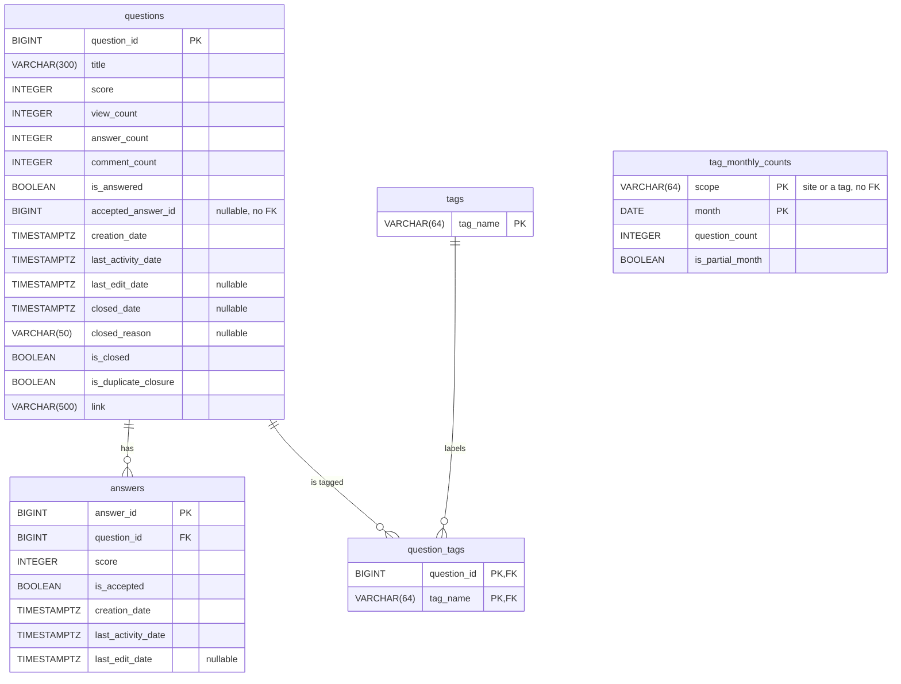

# DAEN 328 Term Project: Stack Overflow Activity Pipeline

A dockerized ETL pipeline that pulls Stack Overflow questions and answers from the
[Stack Exchange API v2.3](https://api.stackexchange.com/docs), cleans them with our own
transform functions, loads them into PostgreSQL, and shows them in a Streamlit dashboard.

No user or account data is collected (see [docs/extraction.md](docs/extraction.md#1-privacy-decision-our-phase-1-risk)).

## Dashboard questions

1. Which tags are growing or shrinking in question volume month over month?
2. How has overall site activity changed over time?
3. Which technologies (tags) tend to appear together?
4. Which tags receive the most attention (score, comments, views)?
5. How long does it take to get a first answer or an accepted answer, by tag?

## Repository layout

```
extract.py          pulls questions, answers, monthly counts from the API   (Carson)
transform.py        cleaning functions                                        (Jeremy)
load.py             schema + upserts into PostgreSQL                          (David)
streamlit_app.py    dashboard                                                 (everyone)
db.py               shared SQLAlchemy engine from .env
tests/              pytest tests
docs/               extraction and transform notes, API key tutorial
Dockerfile, docker-compose.yml                                                (Jonathan)
.env.sample         every environment variable, no secrets
```

## Run it

1. Get a free API key: [docs/stack-exchange-api-key-tutorial.md](docs/stack-exchange-api-key-tutorial.md).
2. `cp .env.sample .env` and fill in `SE_API_KEY` and the `POSTGRES_*` values.
3. `docker-compose up --build`
4. Open the dashboard at http://localhost:8501.

Run the tests with `docker-compose run --rm etl pytest`.

## Layer notes

- [Extraction](docs/extraction.md): sources, privacy, incremental pulls
- [Transform](docs/transform.md): cleaning decisions and next steps

## Schema and ERD



| Table | One row per | Primary key | Foreign keys |
|---|---|---|---|
| `questions` | Stack Overflow question | `question_id` | none |
| `answers` | answer to a question | `answer_id` | `question_id` → `questions` |
| `tags` | distinct tag name | `tag_name` | none |
| `question_tags` | (question, tag) pair; resolves the many-to-many between questions and tags | `(question_id, tag_name)` | `question_id` → `questions`, `tag_name` → `tags` |
| `tag_monthly_counts` | month of question volume for the whole site or one tracked tag | `(scope, month)` | none (see below) |
| `etl_state` | pipeline watermark (created by `extract.py`, not part of the data model) | `source` | none |

**Third normal form.** A question's tags are not stored as a list on the question row. They live in
`question_tags`, so each fact sits in one place: a question's attributes in `questions`, an answer's in
`answers`, and the question-to-tag relationship in `question_tags`. Every non-key column depends only on
its table's whole primary key.

### Key decisions

- **`tag_monthly_counts.scope` has no foreign key.** `scope` is either `'site'` (all of Stack Overflow) or
  a tracked tag such as `'python'`. `'site'` is not a tag, so a foreign key to `tags` would reject it.
  A tracked tag can also be missing from `tags` if no question we pulled carried it yet. Monthly counts
  come from a different API call than the questions, so the two tables are not tied together.
- **`questions.accepted_answer_id` has no foreign key.** We only pull answers for questions in our window,
  and an accepted answer can still be missing (for example when quota runs out mid-run). A foreign key
  would reject the question. It would also create a cycle (`questions` → `answers` → `questions`), so
  neither table could be loaded first. `NULL` means "no accepted answer yet". To get the accepted answer,
  use `LEFT JOIN answers ON answers.answer_id = questions.accepted_answer_id`.
- **`answers.question_id` is a real foreign key.** `extract.py` only asks for answers of questions in the
  same run, and `load.py` loads questions before answers in the same transaction, so the parent row always
  exists. An answer can also attach to a question loaded in an earlier run. If an answer ever arrives whose
  question is in neither place, load skips it and counts it in the run summary, so one bad row can't fail
  the whole run.

## Load layer

`load.py` takes the `TransformResult` from `transform.py` and writes it to PostgreSQL.
It connects through `db.py`, which reads `DATABASE_URL` (our Neon database) or the `POSTGRES_*` variables
from `.env`. No credentials are in code.

| Step | Decision | Why | How it is implemented |
|---|---|---|---|
| 1. Create the schema | Tables, keys and indexes are written by hand with SQLAlchemy Core `Table(...)` definitions. `pandas.to_sql()` is not used. | The assignment requires our own definitions, and `to_sql()` guesses types and creates no keys. Writing the tables in Python keeps one definition for both the DDL and the upserts. | `metadata.create_all(conn, checkfirst=True)` at the start of every run creates whatever is missing and leaves existing tables alone, so the pipeline creates its own tables and no table is made by hand. |
| 2. Convert pandas values | Turn every cell into a plain Python value before inserting. | psycopg2 can't send pandas `NA`/`NaT` or numpy integers. Without this, missing values fail or arrive as the wrong type. | `to_python()` maps `NA`/`NaT`/`NaN` to `None`, `Timestamp` to `datetime`, and numpy scalars to Python `int`/`bool`. `frame_to_rows()` applies it to every row. |
| 3. Upsert, never duplicate | Every table is written with `INSERT ... ON CONFLICT (primary key) DO UPDATE`. | Incremental runs overlap by 5 minutes, and a question's score, views and answers change over time. A record already in the database must be updated, not inserted twice. | `upsert()` builds a PostgreSQL `insert()` with `on_conflict_do_update(index_elements=<primary key>, set_=<every other column from EXCLUDED>)`. It writes in 1,000-row chunks to stay under Postgres's bind-parameter limit. `RETURNING (xmax = 0)` reports each row as inserted or updated for the run summary. Duplicate keys within one batch are dropped first, because Postgres rejects a statement that updates the same row twice. |
| 4. Replace tags per question | For each question in the batch, delete its stored `question_tags` rows, then insert its current tags. | Tags can be edited on Stack Overflow. An upsert alone would add new tags but never remove one that was taken off, so the dashboard's tag counts (Q1, Q3, Q4) would drift. Delete-then-insert makes the stored tags match the latest version of the question. | `replace_question_tags()` runs `DELETE FROM question_tags WHERE question_id IN (...)` for the batch's question ids, then upserts the new pairs. Both happen inside the run's transaction, so readers never see a question with no tags. |
| 5. Load order | `tags` → `questions` → `question_tags` → `answers` → `tag_monthly_counts`. | Parent rows must exist before the child rows that reference them. | The order is fixed in `load()`. |
| 6. One transaction | The whole run commits or none of it does. | A half-loaded run would leave answers without their questions. The watermark is saved only after load commits, so a failed run is simply retried next time. | Everything runs inside one `with engine.begin():` block. |
| 7. Run summary | `load()` returns inserted / updated / skipped counts per table. | The run summary reports what changed in the database. | `summary_lines()` formats them. `python load.py data/raw/<run_stamp>` transforms and loads a saved extract run without calling the API. |

## Incremental pulls

See [docs/extraction.md, section 4](docs/extraction.md#4-incremental-pulls-for-the-readme-section).
_TODO: copy the final version here once the pipeline is done._

## Dashboard screenshot

_TODO_

## Team

| Member | Contribution |
|---|---|
| Carson Phillips (leader) | Extract |
| Jeremy Suen | Transform |
| David Garudo | Load |
| Jonathan Silberstein | Docker |
| Everyone | Dashboard |
